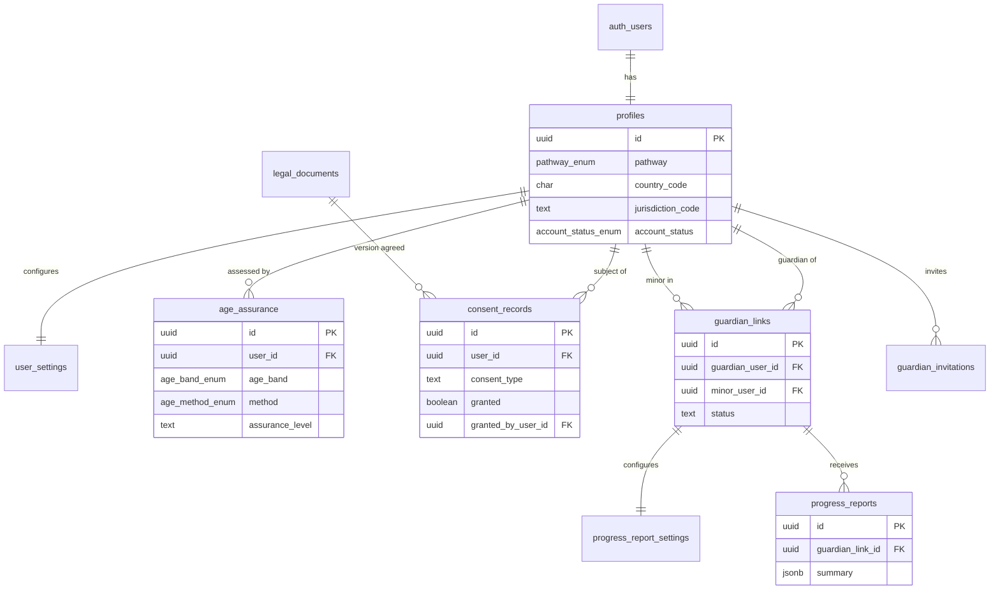
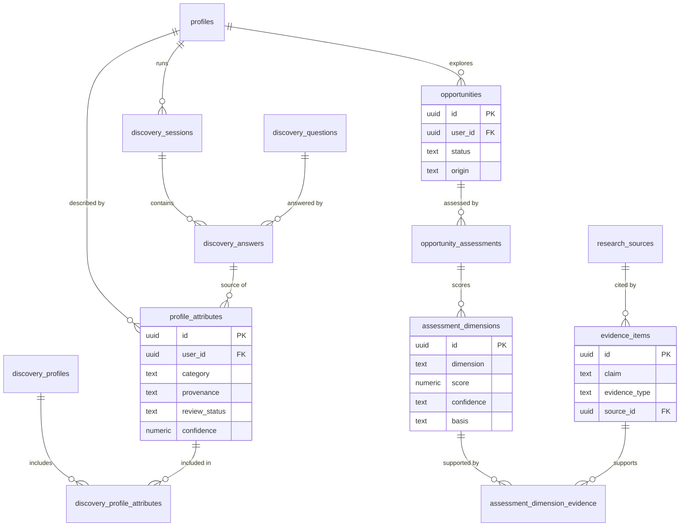
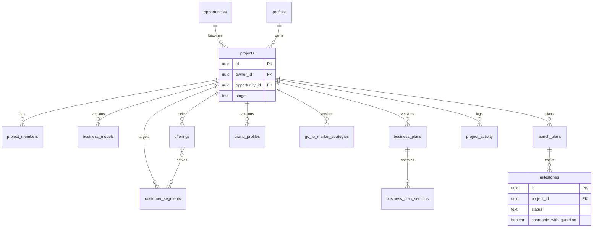
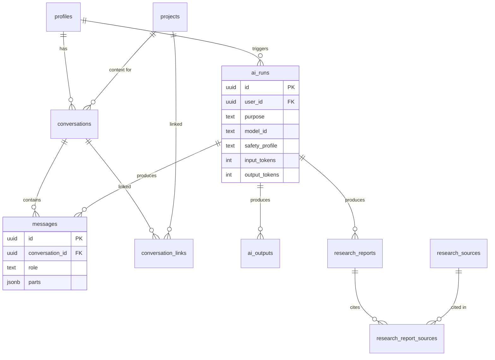
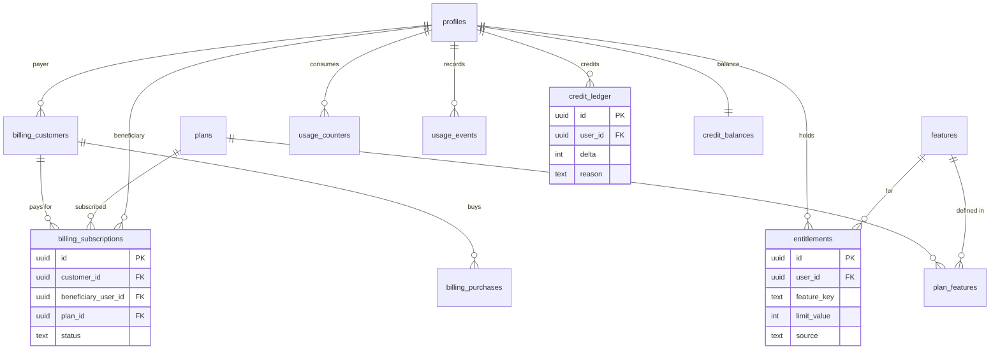

# Foundry — Proposed Database Architecture

**Status:** Proposal for review. Nothing in this document has been created, migrated or applied.
**Target:** PostgreSQL on the existing Supabase project (Sydney, `ap-southeast-2`).
**Scope:** Data model, access control, safeguarding, monetisation, and rollout order.

Decisions that need input are marked **[DECISION Dn]** inline and collected in [Section K](#k-open-decisions).

---

## A. Architecture overview

### A.1 Principles

1. **Database-enforced security.** Every table holding user data has Row Level Security (RLS) enabled. The frontend is never trusted to filter data.
2. **Data minimisation.** Store age *bands* and assurance outcomes, not identity documents. Store only what a feature needs.
3. **Provenance everywhere.** Every fact about a user or a business is tagged as *user-stated*, *AI-inferred*, *user-confirmed*, *verified evidence*, *estimate* or *hypothesis*.
4. **Separation by sensitivity.** General app data, sensitive personal data, billing data and staff/audit data live in different Postgres schemas with different exposure.
5. **Append-only where it matters.** Consent, credit, usage and audit records are never updated in place. Corrections are new rows.
6. **Lifecycle by design.** Every user-owned row is reachable from `user_id` (directly or via a denormalised column), so that export and deletion are mechanical rather than ad hoc.
7. **Migrations in Git.** All DDL ships as versioned SQL files in `supabase/migrations/`, reviewed by pull request.

### A.2 Schema layout

| Schema    | Exposed via Supabase Data API?           | Contents                                                                                           |
| --------- | ---------------------------------------- | -------------------------------------------------------------------------------------------------- |
| `public`  | Yes (RLS-protected)                      | Profiles, discovery, opportunities, projects, AI conversations, entitlements, reference content.   |
| `private` | **No**                                   | Age assurance, guardian invitations, staff roles, audit log, data-rights requests, helper functions. |
| `billing` | **No**                                   | Payment-provider customers, subscriptions, purchases, webhook events.                              |
| `auth`    | Managed by Supabase                      | `auth.users`. Never written to directly by the app.                                               |
| `storage` | Managed by Supabase                      | Private buckets (logos, exports, research snapshots) with path-based policies.                     |

Schemas that aren't exposed can only be reached through server code using the service-role key, or through narrowly scoped `security definer` functions. They can't be queried directly from the browser, even with a valid session.

### A.3 Domain map

```
Identity & Safeguarding ─┬─> Personal Discovery ──> Opportunity Engine ──> Business Development
                         │                                │                       │
                         └──────────── AI Interaction (conversations, runs, outputs) ┘
                                                  │
                          Monetisation (billing → entitlements → usage/credits)
```

### A.4 Conventions

- **Primary keys:** `uuid` with `default gen_random_uuid()`. **[DECISION D14]** UUIDv7 (time-ordered) for very high-volume tables (`messages`, `usage_events`), to improve index locality.
- **Timestamps:** `created_at timestamptz not null default now()`, `updated_at` maintained by a shared trigger.
- **Soft delete:** `deleted_at timestamptz` on user-facing content. Hard purge by scheduled job (see Section I.3).
- **Enums:** Postgres `enum` types for stable vocabularies; lookup tables for vocabularies that change with product (plans, features, question banks).
- **Ownership:** every user-owned table carries `user_id uuid not null references public.profiles(id) on delete cascade`, even when derivable via a parent. This keeps RLS checks a single indexed comparison.
- **Versioned documents:** business models, plans, brand profiles and strategies use `version int` plus `is_current boolean`, with a partial unique index `(project_id) where is_current`.
- **Money:** `amount_minor bigint` plus `currency char(3)` (ISO 4217). Never floats.
- **Country/jurisdiction:** ISO 3166-1 alpha-2 (`AU`) and ISO 3166-2 (`AU-NSW`).

---

## B. Proposed tables

Field lists show important columns only. Every table also has `created_at` and, where mutable, `updated_at`.

### B.1 Identity, accounts and consent

#### `public.profiles`

One row per `auth.users` row. General, non-sensitive account data.

- `id uuid PK` → `auth.users(id) on delete cascade`
- `display_name text`
- `pathway pathway_enum` — `adult` or `young_entrepreneur`. **Set by server only.**
- `country_code char(2)`, `jurisdiction_code text` (for example `AU-VIC`)
- `locale text`, `timezone text`
- `account_status account_status_enum` — `pending_age_assurance`, `pending_guardian_consent`, `active`, `restricted`, `suspended`, `pending_deletion`, `deleted`
- `onboarding_completed_at timestamptz`
- `deleted_at timestamptz`

Constraint: `pathway`, `account_status` and `country_code` aren't user-updatable. This is enforced with column-level `grant update (display_name, locale, timezone)` rather than RLS, because RLS can't restrict individual columns.

#### `private.age_assurance`

Outcome of age assurance. Kept out of `profiles` and out of the API.

- `id uuid PK`, `user_id uuid` → `profiles`
- `method age_method_enum` — `self_declared`, `guardian_attested`, `third_party_estimation`, `document_verified`
- `age_band age_band_enum` — `under_13`, `13_15`, `16_17`, `18_plus`
- `assurance_level` — `low`, `medium`, `high`
- `provider text`, `provider_reference text` (opaque reference only, never document images)
- `assessed_at`, `expires_at`, `superseded_by uuid`
- **[DECISION D2]** Whether to store `birth_year_month` (needed to transition automatically at 18) or only the band plus a computed `adult_on date`.

#### `public.user_settings`

- `user_id uuid PK` → `profiles`
- `ai_personalisation_enabled boolean`
- `ai_memory_enabled boolean` (whether discovery insights feed future prompts)
- `email_product_updates boolean`, `email_marketing boolean` (marketing defaults to `false` and is forced `false` for minors)
- `conversation_retention retention_enum` — `30_days`, `1_year`, `until_deleted`
- `preferences jsonb` (UI-only preferences such as theme and density, validated by a JSON schema check)

#### `public.legal_documents` (reference)

- `id uuid PK`, `doc_type` — `terms`, `privacy`, `ai_use`, `guardian_terms`, `young_entrepreneur_terms`
- `version text`, `jurisdiction_code text null`, `published_at`, `content_url text`
- Unique `(doc_type, version, jurisdiction_code)`

#### `public.consent_records` (append-only)

- `id uuid PK`, `user_id uuid` → `profiles` (the person the consent is *about*)
- `consent_type` — `terms`, `privacy`, `ai_processing`, `marketing`, `guardian_consent`, `progress_reporting`
- `legal_document_id uuid null` → `legal_documents`
- `granted boolean` (withdrawal is a new row with `granted = false`)
- `granted_by_user_id uuid` → `profiles` (self, or the guardian)
- `capture_method` — `checkbox`, `guardian_portal`, `support_assisted`
- `captured_at timestamptz`
- `evidence_hash text` (hash of IP and user agent, not raw values) **[DECISION D7]**

Current consent state comes from a view: `public.current_consents` returns the latest row per `(user_id, consent_type)`.

### B.2 Guardians (young entrepreneur safeguards)

#### `public.guardian_links`

The relationship between a guardian account and a young entrepreneur account.

- `id uuid PK`
- `guardian_user_id uuid` → `profiles`
- `minor_user_id uuid` → `profiles`
- `relationship` — `parent`, `legal_guardian`, `other_authorised_adult`
- `status` — `pending`, `active`, `revoked`, `expired` (expiry happens automatically when the minor turns 18)
- `verification_method text`, `verified_at`
- `can_manage_subscription boolean default true`
- `revoked_at`, `revoked_by uuid`, `revocation_reason text`
- Unique partial index `(guardian_user_id, minor_user_id) where status in ('pending','active')`
- Check: `guardian_user_id <> minor_user_id`

#### `private.guardian_invitations`

- `id uuid PK`, `minor_user_id uuid`
- `invitee_email citext` (deleted as soon as the invitation is accepted or expires)
- `token_hash text unique` (the raw token is never stored)
- `expires_at`, `accepted_at`, `accepted_by_user_id`

#### `public.progress_report_settings`

Opt-in, limited reporting. Both the minor and the guardian must agree.

- `guardian_link_id uuid PK` → `guardian_links`
- `minor_opted_in boolean default false`, `guardian_opted_in boolean default false`
- `frequency` — `weekly`, `monthly`
- `include_milestones boolean`, `include_activity_summary boolean`
- No option exists to include conversations, discovery answers, opportunities or plan content.

#### `public.progress_reports`

Generated server-side, and only from aggregate counts and milestone titles that the minor has marked shareable.

- `id uuid PK`, `guardian_link_id uuid`, `minor_user_id uuid`
- `period_start date`, `period_end date`
- `summary jsonb` — for example `{ "milestones_completed": 3, "active_days": 9, "shared_milestones": ["Registered business name"] }`
- `generated_at`

### B.3 Personal discovery

#### `public.discovery_questions` (reference)

- `id uuid PK`, `key text`, `version int`
- `prompt text`, `help_text text`
- `answer_type` — `free_text`, `single_choice`, `multi_choice`, `scale`
- `options jsonb`
- `audience` — `adult`, `young_entrepreneur`, `all`
- `category` — `skills`, `experience`, `interests`, `resources`, `constraints`, `goals`, `values`
- `is_active boolean`
- Unique `(key, version)`

#### `public.discovery_sessions`

- `id uuid PK`, `user_id uuid`
- `status` — `in_progress`, `completed`, `abandoned`
- `question_set_version int`
- `started_at`, `completed_at`
- `conversation_id uuid null` → `conversations` (for conversational discovery)

#### `public.discovery_answers`

The user's own words. Always classed as user-stated.

- `id uuid PK`, `session_id uuid` → `discovery_sessions`, `user_id uuid`
- `question_id uuid` → `discovery_questions`
- `answer_text text`, `answer_value jsonb`
- `answered_at`, `edited_at`
- Unique `(session_id, question_id)`

#### `public.profile_attributes`

The core of the discovery profile. Each row is one claim about the user, with explicit provenance and a review state.

- `id uuid PK`, `user_id uuid`
- `category` — `skill`, `experience`, `interest`, `resource`, `constraint`, `goal`, `value`
- `label text`, `detail text`
- `provenance` — `user_stated`, `ai_inferred`
- `review_status` — `unreviewed`, `confirmed`, `corrected`, `rejected`
- `confidence numeric(3,2) null` (AI-inferred rows only; must be null for user-stated rows)
- `source_answer_id uuid null` → `discovery_answers`
- `source_message_id uuid null` → `messages`
- `generated_by_run_id uuid null` → `ai_runs`
- `corrected_from_id uuid null` → `profile_attributes` (a correction creates a new row and supersedes the old one)
- `superseded_at timestamptz null`
- Checks:
  - `provenance = 'ai_inferred'` requires `generated_by_run_id is not null`
  - `provenance = 'user_stated'` requires `confidence is null`

The UI shows "We think…" for `ai_inferred` plus `unreviewed`, and "You told us…" for `user_stated` or `confirmed`. AI prompts may use only `confirmed` and `user_stated` rows by default. **[DECISION D9]**

#### `public.discovery_profiles`

Versioned snapshot of the generated profile summary that the user reviews.

- `id uuid PK`, `user_id uuid`, `version int`
- `summary text`, `generated_by_run_id uuid`
- `status` — `draft`, `reviewed`, `superseded`
- `reviewed_at`

#### `public.discovery_profile_attributes` (join)

- `profile_id uuid`, `attribute_id uuid`, PK `(profile_id, attribute_id)`

### B.4 Opportunity engine

#### `public.opportunities`

- `id uuid PK`, `user_id uuid`
- `title text`, `summary text`
- `industry text`, `business_type` — `product`, `service`, `digital`, `hybrid`
- `origin` — `ai_generated`, `user_created`
- `status` — `suggested`, `shortlisted`, `dismissed`, `selected`, `archived`
- `generated_by_run_id uuid null`
- `discovery_profile_id uuid null` (which profile version it was generated from)

#### `public.opportunity_assessments`

One assessment run per opportunity version.

- `id uuid PK`, `opportunity_id uuid`, `user_id uuid`
- `methodology_version text`
- `overall_score numeric(5,2)`, `overall_confidence` — `low`, `medium`, `high`
- `generated_by_run_id uuid`
- `is_current boolean`

#### `public.assessment_dimensions`

- `id uuid PK`, `assessment_id uuid`, `user_id uuid`
- `dimension` — `demand`, `competition`, `differentiation`, `pricing`, `profitability`, `feasibility`, `personal_fit`, `regulatory`, `startup_cost`
- `score numeric(5,2)` (0–100)
- `confidence` — `low`, `medium`, `high`
- `basis` — `verified_evidence`, `estimate`, `hypothesis`
- `rationale text`
- Unique `(assessment_id, dimension)`

#### `public.research_sources`

- `id uuid PK`, `user_id uuid`
- `url text`, `url_hash text`
- `title`, `publisher`, `published_at`, `retrieved_at`
- `source_type` — `government_statistic`, `industry_report`, `news`, `competitor_site`, `marketplace_listing`, `academic`, `user_provided`, `other`
- `reliability` — `high`, `medium`, `low`, `unknown`
- `snapshot_path text null` (private storage object)
- **[DECISION D13]** Per-user (as proposed) or a shared, de-duplicated source cache.

#### `public.evidence_items`

A single claim, numbers included, linked to its source and its epistemic status.

- `id uuid PK`, `user_id uuid`
- `opportunity_id uuid null`, `project_id uuid null` (check: at least one set)
- `source_id uuid null` → `research_sources`
- `claim text`
- `evidence_type` — `verified_fact`, `estimate`, `hypothesis`, `user_reported`
- `value_numeric numeric null`, `value_unit text null`
- `confidence` — `low`, `medium`, `high`
- `generated_by_run_id uuid null`
- Check: `evidence_type = 'verified_fact'` requires `source_id is not null`

#### `public.assessment_dimension_evidence` (join)

- `dimension_id uuid`, `evidence_id uuid`, PK `(dimension_id, evidence_id)`

### B.5 Business development

#### `public.projects`

A business the user is developing. Usually originates from a selected opportunity.

- `id uuid PK`, `owner_id uuid` → `profiles`
- `opportunity_id uuid null`
- `name text`, `tagline text`
- `stage` — `concept`, `validation`, `planning`, `building`, `launching`, `operating`, `growing`, `paused`, `archived`
- `deleted_at`

#### `public.project_members`

Future-proofs collaboration. In v1, only one `owner` row is created per project.

- `project_id uuid`, `user_id uuid`, PK `(project_id, user_id)`
- `role` — `owner`, `editor`, `viewer`
- `added_by uuid`
- **[DECISION D5]** Whether collaboration ships in v1, and whether minors may collaborate.

All business-development tables below carry `project_id uuid not null` and `user_id uuid not null` (the author). RLS uses `private.can_access_project(project_id, min_role)`.

#### `public.business_models` (versioned)

- `value_proposition text`
- `revenue_streams jsonb`, `cost_structure jsonb`
- `channels jsonb`, `key_resources jsonb`, `key_partners jsonb`
- `unfair_advantage text`
- `version int`, `is_current boolean`

#### `public.offerings` (products and services)

- `kind` — `product`, `service`, `digital_product`, `subscription`
- `name`, `description`
- `pricing_model` — `one_off`, `recurring`, `hourly`, `tiered`, `usage`
- `price_amount_minor bigint`, `currency`
- `unit_cost_minor bigint`
- `status` — `idea`, `validating`, `active`, `retired`

#### `public.customer_segments`

These are personas and segments, not real customer records. No third-party personal information is stored.

- `name`, `description`
- `needs jsonb`, `characteristics jsonb`
- `estimated_size numeric`, `size_basis` (`verified_evidence`, `estimate`, `hypothesis`)
- `is_primary boolean`

#### `public.offering_segments` (join)

- `offering_id`, `segment_id`

#### `public.business_plans` (versioned)

- `title`, `status` — `draft`, `in_review`, `final`
- `version int`, `is_current boolean`

#### `public.business_plan_sections`

- `plan_id uuid`, `section_key text` (for example `executive_summary` or `financials`)
- `position int`
- `content_md text`
- `generated_by_run_id uuid null`
- `last_edited_by uuid`
- `provenance` — `ai_draft`, `user_written`, `ai_draft_user_edited`

#### `public.brand_profiles` (versioned)

- `brand_name`, `name_candidates jsonb`
- `positioning_statement`, `mission`, `voice_and_tone jsonb`, `values jsonb`
- `visual_identity jsonb` (palette, typography)
- `logo_path text` (private storage)
- `version`, `is_current`

#### `public.go_to_market_strategies` (versioned)

Marketing and sales strategies share structure, so they live in one table with a `kind` column.

- `kind` — `marketing`, `sales`
- `objectives jsonb`, `channels jsonb`, `messaging jsonb`, `tactics jsonb`, `budget_minor bigint`, `kpis jsonb`
- `version`, `is_current`
- **[DECISION D15]** One table with `kind`, or two separate tables.

#### `public.launch_plans`

- `project_id`, `target_launch_date date`
- `status` — `planning`, `ready`, `launched`, `postponed`
- `launched_at`

#### `public.milestones`

Progress tracking, and the only project data that may appear in a guardian report.

- `project_id`, `launch_plan_id uuid null`
- `title`, `description`
- `category` — `research`, `planning`, `legal`, `product`, `branding`, `marketing`, `sales`, `launch`, `growth`
- `status` — `todo`, `in_progress`, `done`, `skipped`
- `due_date`, `completed_at`, `position int`
- `shareable_with_guardian boolean default false` (only the minor can set this)

#### `public.project_activity` (append-only)

- `project_id`, `user_id`
- `event_type` (for example `milestone_completed`, `plan_finalised` or `stage_changed`)
- `metadata jsonb`, `occurred_at`
- Used for progress analytics and aggregate guardian reports.

### B.6 AI interaction

#### `public.conversations`

- `id uuid PK`, `user_id uuid`
- `context_type` — `general`, `discovery`, `opportunity`, `project`
- `project_id uuid null`, `opportunity_id uuid null`, `discovery_session_id uuid null`
- `title text`
- `retain_until timestamptz null` (derived from `user_settings.conversation_retention`)
- `archived_at`, `deleted_at`

#### `public.conversation_links` (join, many-to-many)

For conversations that later become relevant to additional projects.

- `conversation_id`, `project_id`, PK on both columns
- **[DECISION D11]** Whether many-to-many is needed in v1.

#### `public.messages`

- `id uuid PK` (UUIDv7), `conversation_id uuid`, `user_id uuid`
- `role` — `user`, `assistant`, `system`, `tool`
- `parts jsonb` (AI SDK message parts: text, tool calls and tool results)
- `run_id uuid null` → `ai_runs` (assistant messages)
- `created_at`
- Index `(conversation_id, created_at)`
- Partitioned by month once volume warrants it (see Section I).

#### `public.ai_runs`

One row per model invocation. Provides provenance for every AI-generated row, plus metering.

- `id uuid PK`, `user_id uuid`
- `purpose` — `chat`, `discovery_inference`, `opportunity_generation`, `assessment`, `research`, `plan_drafting`, `branding`, `strategy`
- `model_id text` (Gateway `provider/model`), `prompt_template_key text`, `prompt_version text`
- `input_tokens int`, `output_tokens int`, `cost_microusd bigint`
- `status` — `running`, `succeeded`, `failed`, `cancelled`
- `error_code text null`
- `safety_profile` — `adult`, `young_entrepreneur` (records which guardrails applied)
- `started_at`, `completed_at`
- Written only by the server. Users can read their own rows (to see what generated a result).

#### `public.ai_outputs`

Structured generated artefacts that aren't stored in a domain table, such as draft name lists or ad copy variants.

- `id uuid PK`, `user_id uuid`, `run_id uuid`
- `project_id uuid null`, `opportunity_id uuid null`
- `output_type text`, `content jsonb`
- `is_saved boolean default false`, `title text`

#### `public.research_reports`

Saved research.

- `id uuid PK`, `user_id uuid`
- `project_id uuid null`, `opportunity_id uuid null`
- `title`, `research_question text`, `summary_md text`
- `run_id uuid`, `saved_at`

#### `public.research_report_sources` (join)

- `report_id`, `source_id`

### B.7 Monetisation

#### Reference (public, read-only to authenticated users)

- **`public.plans`**
  - `id`, `code` (`free`, `pro_monthly`, `young_founder`, …), `name`
  - `audience` — `adult`, `young_entrepreneur`, `all`
  - `billing_interval` — `none`, `month`, `year`
  - `provider_price_id text`, `is_active`
- **`public.features`**
  - `key` (`ai_messages`, `research_runs`, `projects`, `plan_export_pdf`, …), `description`
  - `kind` — `boolean`, `metered`, `quota`
- **`public.plan_features`**
  - `plan_id`, `feature_key`, `limit_value int null` (null means unlimited)
  - `reset_period` — `none`, `day`, `month`, `billing_period`
  - `monthly_credit_grant int`

#### Billing (schema `billing`, server-only)

- **`billing.customers`**
  - `id`, `payer_user_id uuid` (an adult, or a guardian), `provider` (`stripe`), `provider_customer_id text unique`
- **`billing.subscriptions`**
  - `id`, `customer_id`, `beneficiary_user_id uuid` (may differ from the payer for guardian-paid plans), `plan_id`
  - `provider_subscription_id unique`
  - `status` — `trialing`, `active`, `past_due`, `canceled`, `incomplete`, `paused`
  - `current_period_start`, `current_period_end`, `cancel_at_period_end`
- **`billing.purchases`**
  - One-off purchases such as credit packs: `id`, `customer_id`, `beneficiary_user_id`, `product_code`, `amount_minor`, `currency`, `provider_payment_id unique`, `status`
- **`billing.webhook_events`**
  - `provider_event_id text unique`, `type`, `payload jsonb`, `received_at`, `processed_at`, `error text`
  - Provides idempotency and replay.

#### Application entitlements (public, read-own, server-write)

- **`public.entitlements`** — the only monetisation table the app reads for access decisions.
  - `id`, `user_id`, `feature_key`
  - `limit_value int null`, `reset_period`
  - `source` — `plan`, `purchase`, `promo`, `staff_grant`, `pathway_default`
  - `source_ref uuid`, `valid_from`, `valid_until`
- **`public.usage_counters`**
  - `user_id`, `feature_key`, `period_start date`, `used int`
  - PK `(user_id, feature_key, period_start)`
- **`public.usage_events`** (append-only)
  - `id` (UUIDv7), `user_id`, `feature_key`, `quantity int`
  - `run_id uuid null`, `idempotency_key text unique`, `occurred_at`
- **`public.credit_ledger`** (append-only)
  - `id`, `user_id`, `delta int` (non-zero)
  - `reason` — `plan_grant`, `purchase`, `consumption`, `refund`, `expiry`, `staff_adjustment`
  - `reference_id uuid`, `expires_at null`, `created_at`
- **`public.credit_balances`**
  - `user_id PK`, `balance int check (balance >= 0)`, `updated_at`
  - A cache, kept in step with the ledger inside the same transaction.

### B.8 Platform operations (schema `private`)

- **`private.staff_roles`**
  - `user_id`, `role` — `support`, `safeguarding`, `billing_admin`, `platform_admin`
  - `granted_by`, `granted_at`, `revoked_at`
  - Unique active `(user_id, role)`
- **`private.audit_log`** (append-only)
  - `id`, `actor_user_id`, `actor_type` (`user`, `staff`, `system`, `webhook`), `action`
  - `target_schema`, `target_table`, `target_id`
  - `reason text`, `metadata jsonb`, `occurred_at`
- **`private.data_requests`**
  - `id`, `user_id`, `request_type` — `export`, `deletion`, `rectification`
  - `status` — `received`, `verifying`, `processing`, `completed`, `rejected`
  - `requested_by uuid` (self, or a guardian for a minor)
  - `export_path text null`, `export_expires_at`, `completed_at`
- **`private.safeguarding_flags`**
  - `id`, `user_id`, `flag_type` (for example `self_harm_signal` or `age_mismatch`), `severity`, `source_run_id`, `status`, `handled_by`, `handled_at`
  - **[DECISION D12]** Whether automated safeguarding detection is in scope.

---

## C. Relationships

| Parent                   | Child                                                                                                                                                         | Cardinality | On delete                                                |
| ------------------------ | ------------------------------------------------------------------------------------------------------------------------------------------------------------- | ----------- | -------------------------------------------------------- |
| `auth.users`             | `profiles`                                                                                                                                                    | 1 : 1       | cascade                                                  |
| `profiles`               | `user_settings`, `credit_balances`                                                                                                                            | 1 : 1       | cascade                                                  |
| `profiles`               | `age_assurance`, `consent_records`, `discovery_sessions`, `profile_attributes`, `opportunities`, `conversations`, `ai_runs`, `entitlements`, `usage_events`, `credit_ledger` | 1 : N       | cascade                                                  |
| `profiles` (guardian)    | `guardian_links.guardian_user_id`                                                                                                                             | 1 : N       | cascade                                                  |
| `profiles` (minor)       | `guardian_links.minor_user_id`                                                                                                                                | 1 : N       | cascade                                                  |
| `guardian_links`         | `progress_report_settings` (1 : 1), `progress_reports` (1 : N)                                                                                                | —           | cascade                                                  |
| `discovery_sessions`     | `discovery_answers`                                                                                                                                           | 1 : N       | cascade                                                  |
| `discovery_questions`    | `discovery_answers`                                                                                                                                           | 1 : N       | restrict (questions are versioned, never deleted)        |
| `discovery_profiles`     | `profile_attributes`                                                                                                                                          | N : M       | via `discovery_profile_attributes`                       |
| `opportunities`          | `opportunity_assessments` → `assessment_dimensions`                                                                                                           | 1 : N : N   | cascade                                                  |
| `assessment_dimensions`  | `evidence_items`                                                                                                                                              | N : M       | via `assessment_dimension_evidence`                      |
| `research_sources`       | `evidence_items`                                                                                                                                              | 1 : N       | set null                                                 |
| `opportunities`          | `projects`                                                                                                                                                    | 1 : N       | set null (a project outlives its opportunity)            |
| `projects`               | `project_members`, `business_models`, `offerings`, `customer_segments`, `business_plans`, `brand_profiles`, `go_to_market_strategies`, `launch_plans`, `milestones`, `project_activity` | 1 : N       | cascade                                                  |
| `business_plans`         | `business_plan_sections`                                                                                                                                      | 1 : N       | cascade                                                  |
| `conversations`          | `messages`                                                                                                                                                    | 1 : N       | cascade                                                  |
| `ai_runs`                | `messages`, `ai_outputs`, `profile_attributes`, `opportunities`, `evidence_items`, `business_plan_sections`, `research_reports`                              | 1 : N       | set null (provenance lost, but content kept)             |
| `plans`                  | `plan_features`, `billing.subscriptions`                                                                                                                      | 1 : N       | restrict                                                 |
| `billing.customers`      | `billing.subscriptions`, `billing.purchases`                                                                                                                  | 1 : N       | restrict (financial records)                             |

---

## D. Entity-relationship diagrams

The model is split by domain to keep each diagram readable.

### D.1 Identity, consent and safeguarding



### D.2 Discovery and opportunities



### D.3 Business development



### D.4 AI interaction



### D.5 Monetisation



---

## E. Proposed Row Level Security policies

### E.1 Helper functions (schema `private`)

Every helper is `stable`, `security definer`, and pinned with `set search_path = ''`, with fully qualified table names. Inside policies, `auth.uid()` is always wrapped as `(select auth.uid())` so Postgres evaluates it once per query rather than once per row.

| Function                                                  | Returns                                                                |
| --------------------------------------------------------- | ---------------------------------------------------------------------- |
| `private.is_staff(role text)`                             | True if the caller holds an active `staff_roles` row with that role.   |
| `private.can_access_project(project_id uuid, min_role text)` | True if the caller is a member with at least `min_role`.            |
| `private.is_active_guardian_of(minor_id uuid)`            | True if an `active` `guardian_links` row exists for the caller.        |
| `private.current_pathway()`                               | The caller's `profiles.pathway`.                                       |
| `private.account_is_active()`                             | True if `profiles.account_status = 'active'`.                          |

### E.2 Policy patterns

**Pattern O — Owner-only** (most user content):

```sql
-- illustrative only; not applied
using      (user_id = (select auth.uid()))
with check (user_id = (select auth.uid()) and private.account_is_active())
```

Applied to: `user_settings`, `discovery_sessions`, `discovery_answers`, `profile_attributes`, `discovery_profiles`, `opportunities`, `opportunity_assessments`, `assessment_dimensions`, `evidence_items`, `research_sources`, `conversations`, `messages`, `ai_outputs`, `research_reports`, and the join tables (through the parent's `user_id`).

**Pattern P — Project membership** (business development):

```sql
using      (private.can_access_project(project_id, 'viewer'))
with check (private.can_access_project(project_id, 'editor') and user_id = (select auth.uid()))
```

Applied to: `business_models`, `offerings`, `customer_segments`, `business_plans`, `business_plan_sections`, `brand_profiles`, `go_to_market_strategies`, `launch_plans`, `milestones`. `projects` itself uses the `viewer` level for select and `owner` for update and delete.

**Pattern R — Read-own, server-write.** Select only where `user_id = (select auth.uid())`. No insert, update or delete policies, so only the service role or `security definer` functions can write.

Applied to: `ai_runs`, `entitlements`, `usage_counters`, `usage_events`, `credit_ledger`, `credit_balances`, `consent_records` (users insert consent through a `security definer` RPC that validates the document version), `progress_reports`.

**Pattern X — Reference content.** Select for `authenticated` where `is_active` (or published). Writes go through migrations or the service role only.

Applied to: `discovery_questions`, `legal_documents`, `plans`, `features`, `plan_features`.

**Pattern N — Not exposed.** All `private.*` and `billing.*` tables: RLS enabled with no policies (deny all), plus `revoke all ... from anon, authenticated`. This is defence in depth even though the schemas aren't exposed through the API.

### E.3 Policy matrix

| Table group                                   | Self (adult)         | Self (young entrepreneur)              | Guardian                                   | Support staff                  | Platform admin              |
| --------------------------------------------- | -------------------- | -------------------------------------- | ------------------------------------------ | ------------------------------ | --------------------------- |
| `profiles`                                    | R/U (limited columns) | R/U (limited columns)                 | R: display name and status of linked minor | R (via admin API, audited)     | R/U (via admin API, audited) |
| `user_settings`                               | R/U                  | R/U (marketing locked off)             | —                                          | —                              | —                           |
| `consent_records`                             | R, insert via RPC    | R, insert via RPC                      | R/insert `guardian_consent` for linked minor | R (audited)                  | R                           |
| Discovery (`discovery_*`, `profile_attributes`) | CRUD               | CRUD                                   | **None**                                   | **None** (break-glass only)    | **None** (break-glass only) |
| Opportunities and research                    | CRUD                 | CRUD                                   | **None**                                   | **None**                       | **None**                    |
| Projects and business development             | CRUD (member)        | CRUD (member)                          | **None**                                   | **None**                       | **None**                    |
| `milestones`                                  | CRUD                 | CRUD                                   | Only via aggregated `progress_reports`     | —                              | —                           |
| Conversations and messages                    | CRUD                 | CRUD                                   | **None**                                   | **None** (break-glass only)    | **None** (break-glass only) |
| `ai_runs`                                     | R                    | R                                      | —                                          | R (metadata only)              | R                           |
| `guardian_links`                              | —                    | R, revoke-request via RPC              | R, revoke own                              | R/U (safeguarding role)        | R/U                         |
| `progress_report_settings`                    | —                    | R/U own opt-in flag                    | R/U own opt-in flag                        | —                              | —                           |
| `progress_reports`                            | —                    | R                                      | R (linked)                                 | —                              | —                           |
| Entitlements, usage, credits                  | R                    | R                                      | R for linked minor (subscription view only) | R                             | R/adjust via audited RPC    |
| `billing.*`                                   | Via server only      | **None**                               | Via server only, for subscriptions they pay | `billing_admin` via server    | Via server                  |
| `private.*`                                   | —                    | —                                      | —                                          | Role-specific via server       | Via server                  |

"Break-glass" means a staff member records a reason, the access is written to `private.audit_log`, and it is time-boxed. **[DECISION D6]**

### E.4 Storage policies

- **Buckets:** `user-files` (private) and `exports` (private, short-lived signed URLs).
- **Path convention:** `{user_id}/{domain}/{object_id}`.
- **Policy:** `(storage.foldername(name))[1] = (select auth.uid())::text`.
- **Project assets:** stored under `projects/{project_id}/…` and checked with `private.can_access_project`.

---

## F. User roles and permission boundaries

| Role                       | How it's determined                                           | Boundary                                                                                                                                                                       |
| -------------------------- | ------------------------------------------------------------- | ------------------------------------------------------------------------------------------------------------------------------------------------------------------------------ |
| `anon`                     | No session                                                    | Can read published `legal_documents` and `plans` only. Nothing user-related.                                                                                                   |
| Adult entrepreneur         | `profiles.pathway = 'adult'` and `account_status = 'active'`  | Full control of their own data. Can pay for themselves.                                                                                                                        |
| Young entrepreneur         | `pathway = 'young_entrepreneur'`                              | Full control of their own content. Cannot be a `billing.customers` payer **[DECISION D4]**. Marketing consent locked off. Stricter AI safety profile. Shorter default retention. |
| Guardian                   | Has at least one `active` `guardian_links` row                | Separate login. Can see link status, subscription status, and opt-in progress reports only. Can pay for and cancel the minor's plan. Cannot read content.                      |
| Support                    | `private.staff_roles.role = 'support'`                        | Account metadata and status. No content without break-glass.                                                                                                                   |
| Safeguarding               | `role = 'safeguarding'`                                       | Guardian links, age assurance outcomes, safeguarding flags. Content only via audited break-glass.                                                                              |
| Billing admin              | `role = 'billing_admin'`                                      | `billing.*`, entitlements, credit adjustments via audited RPC.                                                                                                                 |
| Platform admin             | `role = 'platform_admin'`                                     | Manages staff roles and reference content. Content access still requires break-glass.                                                                                          |
| `service_role` (server)    | Server-side key only, never sent to the browser               | Bypasses RLS. Used only in webhook handlers, AI-run recording, scheduled jobs and admin APIs. Every use that touches user data writes an audit row.                            |

Staff roles live in a table, not in JWT `user_metadata`, because user metadata is user-editable. **[DECISION D8]** Optionally mirror staff roles into `app_metadata` claims through a Supabase custom access token hook, for faster checks.

One person may hold several roles; a guardian may also be an adult entrepreneur. **[DECISION D10]**

---

## G. Adult and young entrepreneur separation

### G.1 Approach

Both pathways share one set of tables. They're separated *logically*, through four mechanisms:

1. **Server-controlled `pathway`.** Derived from `private.age_assurance` and written only by the server. Users can't change it through the API.
2. **Pathway-aware defaults.** On creation, minors get stricter `user_settings`: marketing off, shortest retention, AI memory off until reviewed.
3. **Pathway-aware AI.** Every `ai_runs` row records `safety_profile`. The server picks the system prompt, model and tool set from the pathway, never from client input.
4. **Pathway-aware entitlements.** Some features (for example external outreach tools or paid advertising guidance) are absent from young-entrepreneur plans. `entitlements` enforces this server-side.

Physically separate tables or databases were considered and rejected. They double the migration surface, and complicate the transition at 18, without a meaningful security gain over RLS plus server-controlled pathway. **[DECISION D3]** Confirm this, or flag a regulatory reason to separate physically.

### G.2 Guardian access is opt-in, minimal and revocable

- No RLS policy anywhere grants a guardian access to discovery, opportunities, conversations, messages, research or plan content. This is enforced by the *absence* of policies, and a pgTAP test asserts it stays that way.
- Progress reports are generated by a server job from `milestones` where `shareable_with_guardian = true`, plus aggregate counts. Both `minor_opted_in` and `guardian_opted_in` must be true.
- A minor can request to end a guardian link. Whether that takes effect immediately or needs safeguarding review depends on the jurisdiction. **[DECISION D1]**

### G.3 Lifecycle

```
sign up → age assurance → (under threshold) pending_guardian_consent → guardian invited
        → guardian accepts + consents → active young_entrepreneur
        → turns 18 → pathway flips to adult, guardian_links expire, reports stop,
                     user prompted to re-consent to adult terms; all content stays with the user
```

### G.4 Data handling differences

| Aspect                                 | Adult                         | Young entrepreneur                                                       |
| -------------------------------------- | ----------------------------- | ------------------------------------------------------------------------ |
| Default conversation retention         | 1 year                        | 30 days **[DECISION D7]**                                                |
| Marketing email                        | Opt-in                        | Not available                                                            |
| AI-inferred attributes used in prompts | After review (configurable)   | Only after the user confirms them                                        |
| Payment                                | Self                          | Guardian only                                                            |
| Deletion request                       | Self                          | Self, or guardian (jurisdiction-dependent)                               |
| Export                                 | Self                          | Self. Guardian receives a progress summary only, unless the law requires otherwise. |

---

## H. Subscriptions and usage limits

### H.1 Flow

```
Payment provider ──webhook──> /api/webhooks/billing (server, signature verified)
   → insert billing.webhook_events (idempotent on provider_event_id)
   → upsert billing.subscriptions / billing.purchases
   → call private.sync_entitlements(beneficiary_user_id)
        → rebuilds public.entitlements from active subscriptions + purchases + grants + pathway defaults
        → grants plan credits into public.credit_ledger (once per period, idempotent)
```

The application never reads `billing.*` to decide access. It reads `public.entitlements` only. This keeps billing records and application entitlements logically separate, and lets promos and staff grants work without fake billing rows.

### H.2 Enforcement

All metered actions go through one server-side function:

```
private.consume(user_id, feature_key, quantity, idempotency_key) → { allowed, remaining }
```

Inside a single transaction, it:

1. Resolves the effective limit from `entitlements` (the highest active limit; null means unlimited).
2. Locks the `usage_counters` row with `select … for update` and checks `used + quantity <= limit`.
3. For credit-priced features, locks `credit_balances` and checks `balance >= cost`. It then appends a negative `credit_ledger` row.
4. Appends `usage_events`, deduplicated on `idempotency_key` so retries never double-charge.
5. Returns the result. The API route rejects the AI call before invoking the model if it isn't allowed.

### H.3 Credits

- **Sources:** plan grants (monthly), purchased packs, refunds and staff adjustments. Each is a ledger row.
- **Spending:** consumption is negative ledger rows. `credit_balances` can never go negative (check constraint).
- **Expiry:** **[DECISION D16]** Whether credits expire or roll over. Expiry is a scheduled job that writes `expiry` rows.

### H.4 Free plan

Every active profile gets `pathway_default` entitlements at sign-up, so the app works with no billing rows at all.

---

## I. Scalability and security concerns

### I.1 Scalability

| Concern                                                        | Mitigation                                                                                                                                       |
| -------------------------------------------------------------- | ------------------------------------------------------------------------------------------------------------------------------------------------ |
| `messages` and `usage_events` grow fastest                     | UUIDv7 keys. Monthly declarative partitioning once past ~10M rows. Old usage rolled into `usage_counters`.                                       |
| RLS cost on large tables                                       | Denormalised `user_id` and a B-tree index on every policy column. `(select auth.uid())` wrapping. Avoid joins in policies.                       |
| `can_access_project` called per row                            | Marked `stable`, with an index on `project_members(user_id, project_id)`. If needed, cache membership in JWT claims later.                        |
| Large `jsonb` documents (plans, strategies)                    | Keep to structured fragments. Long prose in `text` columns. Consider a TOAST compression setting.                                                |
| Semantic search over research and discovery                    | **[DECISION D17]** `pgvector` embeddings tables, isolated per user with the same RLS.                                                           |
| Connection limits from serverless                              | Use the Supabase pooled connection (already configured). Prefer the Data API from Next.js.                                                       |

### I.2 Security

| Risk                                                                     | Mitigation                                                                                                                                                                                         |
| ------------------------------------------------------------------------ | -------------------------------------------------------------------------------------------------------------------------------------------------------------------------------------------------- |
| Service-role key misuse                                                  | Import only in `server-only` modules. Never in `NEXT_PUBLIC_*`. Every service-role write touching user data writes to the audit log.                                                               |
| Users escalating `pathway`, `account_status` or `provenance` via update  | Column-level grants. Triggers rejecting changes to protected columns from the `authenticated` role.                                                                                               |
| AI-inferred data presented as fact                                       | `provenance` checks. UI labelling. Prompts consume confirmed data by default.                                                                                                                      |
| Prompt injection via scraped research content                            | Store raw source snapshots separately from evidence claims. Treat tool output as untrusted. Never let model output set security-relevant columns.                                                  |
| Data residency                                                           | The database is in Sydney, but AI Gateway model providers may process prompts outside Australia. **[DECISION D18]** Confirm whether this is acceptable, especially for minors.                    |
| Deleted data persisting in backups                                       | Point-in-time recovery retains data for the backup window. Document this in the privacy policy. Re-apply pending deletions after any restore (deletion tombstones kept in `private.data_requests`). |
| Guardian account takeover exposing a minor                               | Guardians never see content. Link changes notify the minor. Safeguarding review on disputes.                                                                                                       |
| Audit log tampering                                                      | `private.audit_log` is insert-only. No update or delete grants to any role except the migration owner.                                                                                             |

### I.3 Retention, export and deletion

- **Export:** a server job walks every table with `user_id` (generated from a registry view of user-owned tables). It writes JSON plus files to the `exports` bucket and issues a signed URL valid for 7 days.
- **Deletion:** `account_status = 'pending_deletion'` blocks access immediately. A hard delete follows after a grace period **[DECISION D7]**, by deleting `auth.users`, which cascades.
  - Billing records are kept for the legally required period, with personal fields nulled. Payer is retained only as a provider reference.
  - Audit rows are kept with `actor_user_id` nulled.
- **Conversation retention:** a nightly `pg_cron` job hard-deletes conversations past `retain_until`.
- **Consent records:** retained after account deletion for the evidential period, then purged.

---

## J. Recommended implementation sequence

Each step is its own migration file and pull request, with pgTAP RLS tests and regenerated `src/types/database.ts`.

| Step | Migration                     | Contents                                                                                                                                                   | Unblocks                       |
| ---- | ----------------------------- | ---------------------------------------------------------------------------------------------------------------------------------------------------------- | ------------------------------ |
| 0    | Tooling                       | `supabase/migrations/` folder, migration naming, CI that applies migrations to a branch database and runs pgTAP, and type generation. **[DECISION D19]**   | Everything                     |
| 1    | `0001_foundations`            | `private` and `billing` schemas, enums, `updated_at` trigger, helper functions, `staff_roles`, `audit_log`, privilege revokes.                             | All later steps                |
| 2    | `0002_identity`               | `profiles`, `user_settings`, `legal_documents`, `consent_records`, `age_assurance`, sign-up trigger creating profile and settings, consent RPC.            | Auth UI                        |
| 3    | `0003_guardians`              | `guardian_links`, `guardian_invitations`, `progress_report_settings`, `progress_reports`.                                                                  | Young entrepreneur sign-up     |
| 4    | `0004_entitlements`           | `plans`, `features`, `plan_features`, `entitlements`, `usage_*`, `credit_*`, `consume()`; free-plan defaults.                                              | Any AI feature (metering)      |
| 5    | `0005_ai_core`                | `conversations`, `messages`, `ai_runs`, `ai_outputs`.                                                                                                      | Chat, discovery AI             |
| 6    | `0006_discovery`              | `discovery_*`, `profile_attributes`.                                                                                                                       | Discovery experience           |
| 7    | `0007_opportunities`          | `opportunities`, assessments, dimensions, `research_sources`, `evidence_items`, `research_reports`.                                                       | Opportunity engine             |
| 8    | `0008_projects`               | `projects`, `project_members`, `can_access_project`, all business-development tables, `milestones`, `project_activity`, `conversation_links`.             | Business builder               |
| 9    | `0009_billing`                | `billing.*`, webhook route, `sync_entitlements`. Requires the payment provider integration.                                                                | Paid plans                     |
| 10   | `0010_lifecycle`              | `data_requests`, export and deletion jobs, retention `pg_cron` schedules, pathway transition at 18.                                                        | Launch readiness               |
| 11   | `0011_safeguarding` (optional) | `safeguarding_flags` and review tooling.                                                                                                                  | —                              |

Billing (step 9) comes after metering (step 4) on purpose: the app can launch on free-plan entitlements before payments exist.

---

## K. Open decisions

| ID  | Question                                                                                                                                                                               | Why it matters                                                                                                    | Suggested default                                                                                                                                      |
| --- | -------------------------------------------------------------------------------------------------------------------------------------------------------------------------------------- | ----------------------------------------------------------------------------------------------------------------- | ------------------------------------------------------------------------------------------------------------------------------------------------------ |
| D1  | Which countries do we launch in, and what is the minimum age? Is under-13 supported at all?                                                                                            | Drives guardian-consent rules, age bands and legal review (Australian Privacy Act and Children's Online Privacy Code, GDPR Art. 8, COPPA, UK Age Appropriate Design Code). | Australia first. Minimum age 13. Guardian consent required under 16. Obtain legal advice before launch.                                               |
| D2  | Which age-assurance method do we use, and do we store a birth year and month?                                                                                                          | Assurance strength versus data minimisation, and automatic transition at 18.                                     | Self-declaration plus guardian attestation. Store only the band and `adult_on` date.                                                                  |
| D3  | Logical separation (shared tables) or physical separation for minors?                                                                                                                  | Complexity versus perceived isolation.                                                                            | Logical separation, as proposed.                                                                                                                       |
| D4  | May young entrepreneurs make any purchase themselves?                                                                                                                                  | Billing model and consumer law.                                                                                   | No. Guardian pays.                                                                                                                                     |
| D5  | Is project collaboration in v1? May minors collaborate with others?                                                                                                                    | `project_members` policies and safeguarding.                                                                     | Schema-ready, but disabled in v1. No minor collaboration.                                                                                              |
| D6  | Is break-glass staff access to content permitted? Who approves it?                                                                                                                      | Privacy commitments and support capability.                                                                      | Permitted only for safeguarding or legal reasons, with a recorded reason, two-person approval and audit.                                               |
| D7  | Retention periods: conversations, deletion grace period, consent evidence, billing records. Do we hash IP addresses?                                                                   | Privacy policy and storage cost.                                                                                  | Adults 1 year, minors 30 days, deletion grace period 30 days, billing 7 years (Australian tax), IP hashed.                                            |
| D8  | Mirror staff roles into JWT claims via a custom access token hook?                                                                                                                      | Performance versus revocation lag.                                                                               | Not initially.                                                                                                                                         |
| D9  | May AI-inferred, unreviewed attributes inform later prompts?                                                                                                                            | Accuracy and user trust.                                                                                          | Adults: yes, labelled as unconfirmed. Minors: no.                                                                                                      |
| D10 | Can one account be both a guardian and an entrepreneur?                                                                                                                                 | Profile model and UI.                                                                                             | Yes. Guardian is a relationship, not an account type.                                                                                                  |
| D11 | Do conversations need to link to more than one project?                                                                                                                                 | Whether `conversation_links` is needed in v1.                                                                     | Single `project_id` in v1. Add the join table later.                                                                                                   |
| D12 | Is automated safeguarding detection (for example distress signals in conversations) in scope?                                                                                           | Duty-of-care obligations and staffing.                                                                            | Scope it with legal and safeguarding advice. Schema reserved.                                                                                         |
| D13 | Are research sources shared across users or per user?                                                                                                                                   | Storage cost versus cross-user leakage.                                                                           | Per user in v1.                                                                                                                                        |
| D14 | UUIDv7 for high-volume tables?                                                                                                                                                          | Index performance.                                                                                                | Yes, generated in application code or with the `pg_uuidv7` extension if available.                                                                    |
| D15 | One `go_to_market_strategies` table, or separate marketing and sales tables?                                                                                                            | Schema clarity versus duplication.                                                                                | One table with `kind`.                                                                                                                                 |
| D16 | Do credits expire? Do plan credits roll over?                                                                                                                                           | Ledger jobs and consumer-law disclosure.                                                                          | Plan credits reset each period. Purchased credits expire after 12 months.                                                                             |
| D17 | Are vector embeddings needed for semantic search over research or discovery?                                                                                                            | Requires the `pgvector` extension and adds cost.                                                                  | Defer until after the core flows ship.                                                                                                                 |
| D18 | Is AI processing outside Australia acceptable, including for minors' data?                                                                                                              | Data residency and privacy-policy disclosure.                                                                     | Disclose it. Prefer providers with zero data retention.                                                                                                |
| D19 | Migration workflow: Supabase CLI in CI (`supabase db push`), or manual application?                                                                                                     | Reproducibility and review.                                                                                       | Supabase CLI in GitHub Actions, applying to a preview branch database first, then production on merge to `main`.                                      |
| D20 | Which payment provider?                                                                                                                                                                 | `billing.*` shape and webhook handling.                                                                           | Stripe.                                                                                                                                                |

---

*No database objects, migrations, Supabase settings or application code were changed in producing this document.*
